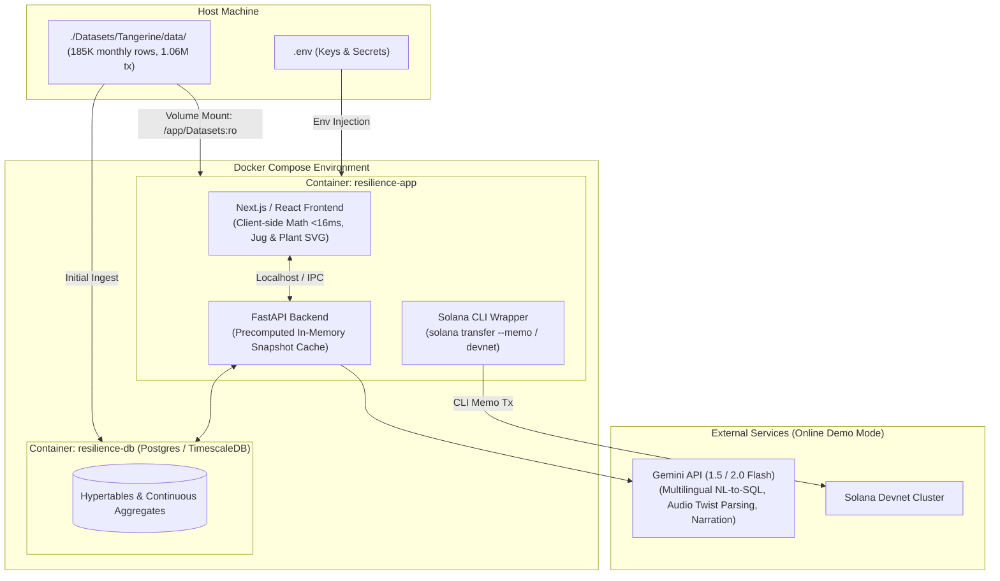
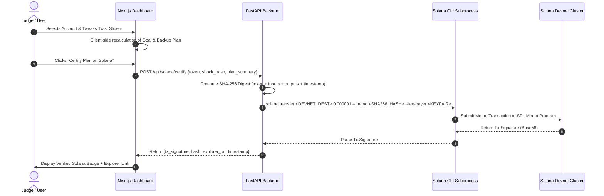
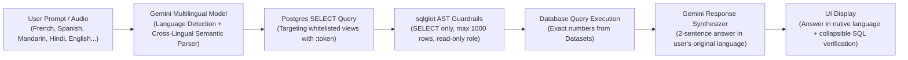

# Resilience Rewired: Prototype Architecture & Execution Plan

> **Track**: Tangerine · Sheridan Datathon 2026 (November 7–8)  
> **Challenge**: Real-time Financial Resilience Engine under Macro & Personal Shocks  
> **Updated Constraints**:
> 1. **Solana CLI** for tamper-evident advice receipts and verification (no heavy SDK dependencies).
> 2. **Docker & Docker Compose** for complete containerization, replacing cloud VM deployment (Vultr).
> 3. **Local Dataset Access** directly mounted from `./Datasets/Tangerine/data/`.

---

## 1. Executive Summary & Key Pivots

This plan adapts the design from the project specification into a production-grade, offline-capable hackathon prototype containerized with Docker, integrating Solana CLI for immutable advice receipts, and reading directly from local data.



### The Three Key Architectural Pivots

| Dimension | Original README Spec | Updated Plan | Benefit / Justification |
| :--- | :--- | :--- | :--- |
| **Blockchain** | In-app Web3 Solana SDK (`@solana/web3.js` or Python SDK) | **Solana CLI** (`solana transfer --memo`, `solana confirm`) driven via automated backend worker / CLI runner | Completely eliminates complex client-side wallet pairing, browser extension popups, and fragile RPC SDK version mismatches during judging. Zero frontend wallet friction. |
| **Infrastructure** | Cloud VPS (Vultr VM) with laptop fallback | **Full Docker & Docker Compose** orchestration (`docker-compose up --build`) | Eliminates cloud hosting costs, DNS setup, and remote latency. Provides 100% deterministic local containerization with offline resilience if venue Wi-Fi drops. |
| **Data Layer** | Cloud database / `/mnt/user-data/uploads/` path | **Direct relative binding to `./Datasets/Tangerine/data/`** | Standardizes file ingestion directly from repository datasets for `analyze.py`, precompute pipelines, and Docker container volume mounts. |

---

## 2. Core Formulas & Mathematical Specification

Judges test customer resilience using exact deterministic formulas. The engine must compute these in pure TypeScript client-side (<16 ms) while keeping an identical reference implementation in Python (`calc.py`).

### 2.1 Judges' Standard Definitions

All calculated from `monthly_summary.csv` sorted by `month` per `account_id`:

$$I = \text{median}(\text{money\_in})$$
$$S = \text{median}(\text{money\_out})$$
$$F = \text{median}(\text{household\_bills} + \text{insurance} + \text{loan\_payments}) \quad \text{(Display Only)}$$
$$H = \text{median}(\text{household\_bills})$$
$$B = \text{mean}(\text{avg\_daily\_balance of last 6 rows})$$
$$P = \text{loans.monthly\_payment if loans.status} \in \{C, D\} \text{ else } 0$$

#### Runway Calculation
$$\text{buffer\_left} = B - \text{one\_off\_costs}$$
$$\text{gap} = \text{spend\_after} - \text{income\_after}$$

$$\text{runway} = \begin{cases} 
0 & \text{if } \text{buffer\_left} \le 0 \\
\text{"no shortfall (120+)"} & \text{if } \text{gap} \le 0 \\
\min\left(\frac{\text{buffer\_left}}{\text{gap}}, 120\right) & \text{otherwise}
\end{cases}$$

*Rounded to 1 decimal place. Account survives shock duration $D$ (months) if $\text{runway} \ge D$.*

### 2.2 Twist Shocks Matrix

| Shock Scenario | Income After Shock | Spending After Shock | One-Off Costs |
| :--- | :--- | :--- | :--- |
| **Layoff (EI $x\%$)** | $(x / 100) \cdot I$ | $S$ | $0$ |
| **Household Bills $+y\%$** | $I$ | $S + (y / 100) \cdot H$ | $0$ |
| **Emergency Repair ($k$ mo spend)** | $I$ | $S$ | $k \cdot S$ |
| **Compound Twist** | Apply income drops | Apply cost increases | Apply one-off costs |

> **Validation Benchmark (Account 20111)**:  
> $I = 6,339.4 \cdot S = 8,599.6 \cdot F = 2,330.1 \cdot H = 0 \cdot B = 17,611.9 \cdot P = 2,330.2$  
> Baseline Runway: **7.8 mo** | 6-month Layoff Runway (EI 55%): **3.4 mo**.

---

## 3. Solana CLI Integration Architecture

Rather than requiring judges to connect Phantom/Solflare wallets or embedding fragile JavaScript Web3 transaction builders, we use a headless **Solana CLI** pipeline embedded into the backend container.

### 3.1 Tamper-Evident Receipt Generation Pipeline



### 3.2 Solana CLI Configuration & Scripts

1. **Container Tooling**: Install `solana-cli` in the Dockerfile.
2. **Keypair Generation**:
   ```bash
   # Automated entrypoint or setup script
   solana-keygen new --no-bip39-passphrase -o /app/keys/auditor-wallet.json --silent
   solana config set --url https://api.devnet.solana.com --keypair /app/keys/auditor-wallet.json
   solana airdrop 2 /app/keys/auditor-wallet.json
   ```
3. **Receipt Emission Script (`backend/services/solana_cli.py`)**:
   - Executes `solana transfer` with `--memo "RESILIENCE:<SHA256>"` to write tamper-proof hashes directly to the Solana Memo program.
4. **Verification**:
   - A `solana confirm -v <TX_SIG>` CLI command re-inspects transaction memo logs on demand to prove authenticity without relying on third-party indexers.

---

## 4. Docker Architecture & Ingestion Pipeline

### 4.1 Directory & File Layout

```
Hackathon2026/
├── Datasets/
│   └── Tangerine/
│       ├── data/
│       │   ├── monthly_summary.csv
│       │   ├── loans.csv
│       │   ├── accounts.csv
│       │   └── transactions.csv
│       └── README.md
├── docker-compose.yml
├── Dockerfile
├── .dockerignore
├── .env.example
├── analyze.py                 # Updated to point to Datasets/Tangerine/data
├── pipeline/
│   ├── calc.py                # Reference formula implementation
│   ├── precompute.py          # Fast binary & JSON snapshot pre-generator
│   └── tests/
│       └── test_calc.py       # Unit tests for edge cases & account 20111
├── backend/
│   ├── main.py                # FastAPI endpoints
│   ├── routes/
│   │   ├── snapshot.py        # /snapshot/{token}
│   │   ├── population.py      # /population
│   │   ├── ask.py             # NL-to-SQL + Gemini
│   │   └── solana.py          # Solana CLI wrapper
│   └── guardrails/            # sqlglot SQL query validation
└── frontend/
    ├── src/
    │   ├── lib/calc.ts        # Pure TypeScript port of calc.py
    │   ├── components/
    │   │   ├── JugPlant.tsx   # Procedural SVG resilience metaphor
    │   │   ├── Shocks.tsx     # Dynamic twist controls
    │   │   ├── Snapshot.tsx   # Income/Spend/Runway cards
    │   │   └── SolanaBadge.tsx# On-chain proof verification
    │   └── pages/ or app/
```

### 4.2 Docker Compose Configuration (`docker-compose.yml`)

```yaml
version: '3.8'

services:
  resilience-app:
    build:
      context: .
      dockerfile: Dockerfile
    container_name: resilience-app
    ports:
      - "3000:3000"   # Frontend Web UI
      - "8000:8000"   # FastAPI Backend
    volumes:
      - ./Datasets:/app/Datasets:ro       # Read-only mount of actual dataset files
      - solana-keys:/app/keys             # Persistent devnet wallet keypair
      - precomputed-cache:/app/cache      # Precomputed JSON & binary cache
    environment:
      - DATASET_PATH=/app/Datasets/Tangerine/data
      - GEMINI_API_KEY=${GEMINI_API_KEY:-}
      - SOLANA_NETWORK=devnet
      - SOLANA_KEYPAIR_PATH=/app/keys/auditor-wallet.json
    restart: unless-stopped

volumes:
  solana-keys:
  precomputed-cache:
```

### 4.3 Data Path Normalization

Update all scripts to read from:
`./Datasets/Tangerine/data/` (host) or `/app/Datasets/Tangerine/data/` (Docker container), ensuring complete isolation and no hardcoded personal directory strings.

---

## 5. Multilingual Natural Language to SQL Engine (Gemini API)

To serve Canada’s bilingual banking ecosystem and multicultural customer base, Gemini is instructed to translate queries submitted in **any language** (e.g. French, Spanish, Mandarin, Hindi, Punjabi, Arabic, German, or English) directly into executable SQL queries, with zero number hallucinations.



### 5.1 Cross-Lingual Translation & SQL Mapping

The Gemini prompt includes view definitions, column definitions, and multi-language semantic mappings:
- **French (Official Canadian)**:
  - *"Quel a été mon mois avec les dépenses les plus élevées en 2024 ?"*  
    $\to$ `SELECT month, money_out FROM v_account_month WHERE token = :token AND month LIKE '2024%' ORDER BY money_out DESC LIMIT 1;`
  - *"Quelle part des titulaires de prêts ne survivrait pas à un licenciement ?"*  
    $\to$ `SELECT AVG(CASE WHEN runway_layoff < 6 THEN 1.0 ELSE 0.0 END) * 100 AS pct_fail FROM v_population WHERE has_loan = true;`
- **Spanish**:
  - *"¿Cuánto gasto en facturas del hogar en promedio cada mes?"*  
    $\to$ `SELECT H FROM v_account_snapshot WHERE token = :token;`
- **Mandarin**:
  - *"哪个月份的现金存款最多？"*  
    $\to$ `SELECT month, cash_deposits FROM v_account_month WHERE token = :token ORDER BY cash_deposits DESC LIMIT 1;`
- **Hindi**:
  - *"क्या इस खाते का बैलेंस पिछले 6 महीनों में कभी शून्य से नीचे गया है?"*  
    $\to$ `SELECT SUM(days_below_zero) AS overdraft_days FROM v_account_month WHERE token = :token AND month >= '2025-07';`

### 5.2 Four-Tier Production Guardrails
1. **Read-Only Database Role**: Connections for NL-to-SQL run under `nl_reader` with `SELECT` permissions only on whitelisted views (`v_account_month`, `v_account_snapshot`, `v_population`).
2. **`sqlglot` AST Validation**:
   ```python
   def validate_sql(sql: str, max_rows: int = 1000) -> str:
       tree = sqlglot.parse_one(sql)
       if not isinstance(tree, sqlglot.exp.Select):
           raise ValueError("Unauthorized query: Only SELECT statements are permitted.")
       if not tree.args.get("limit"):
           tree = tree.limit(max_rows)
       return tree.sql()
   ```
3. **Execution Timeout**: `ALTER ROLE nl_reader SET statement_timeout = '5s';` aborts runaway aggregates before they can freeze the live judging session.
4. **Bilingual/Native Language Grounding**: Gemini is strictly instructed to quote only exact numerical values returned by the SQL execution when synthesizing the natural language summary in the user's queried language.

---

## 6. UI & Metaphor: The Jug-and-Plant Visualizer

The UI features a procedural SVG component representing financial health:

| Component State | Underlying Data Metric | Visual Representation |
| :--- | :--- | :--- |
| **Jug Fill Level** | $\frac{\text{buffer\_left}}{\text{target\_6mo}}$ | 0–100% blue water; turns amber/red if below shock requirement |
| **Inflow Stream** | Monthly Savings Rate + Cuts | Dynamic pouring stream into the jug |
| **Outflow Leak** | Monthly Deficit Under Shock | Dripping/gushing leak at jug base |
| **Plant Growth** | $\min\left(\frac{\text{runway}}{D}, 2.0\right)$ | Plant stems extend upwards past the target threshold |
| **Foliage Health** | Runway vs. Shock Duration $D$ | Wilting brown leaves if $\text{runway} < D$; lush green if $\ge D$; flowers if emergency fund $\ge 6$ mo |
| **Pot Integrity** | Buffer $B$ | Cracks appear in terracotta pot if $B \le 0$ |

---

## 7. Phased Implementation Roadmap

```mermaid
gantt
    title Prototype Build Schedule
    dateFormat  HH:mm
    axisFormat  %H:%M
    
    section Data & Core Math
    Refactor analyze.py & local paths       :p0_1, 00:00, 1h
    Implement pipeline/calc.py & pytest     :p0_2, after p0_1, 1h
    Precompute snapshots & population.bin   :p0_3, after p0_2, 2h

    section Solana CLI
    Setup Solana CLI container & devnet     :p1_1, after p0_3, 1h
    Build Memo receipt service & verify CLI :p1_2, after p1_1, 1h

    section Backend & Gemini
    FastAPI /snapshot & /population         :p2_1, after p1_2, 2h
    Multilingual NL-to-SQL + Voice Twist    :p2_2, after p2_1, 2h
    SQL Guardrails (sqlglot LIMIT & SELECT) :p2_3, after p2_2, 1h

    section Frontend
    Next.js calc.ts port & Snapshot UI      :p3_1, after p2_3, 2h
    Shock sliders & Jug-and-Plant SVG       :p3_2, after p3_1, 3h
    Bank-wide Population & Segments Tab     :p3_3, after p3_2, 2h

    section Packaging & Polish
    Docker & Docker Compose container build :p4_1, after p3_3, 2h
    Rehearsal with 10 Random Accounts       :p4_2, after p4_1, 2h
```



### Phase Details

#### Phase 0: Data Pipeline & Reference Math (Hours 0–4)
- Update `analyze.py` to point to `./Datasets/Tangerine/data/`.
- Build `pipeline/calc.py` with judges' formulas and unit tests covering edge cases ($B \le 0$, quiet months, $H=0$, account 20111 verification).
- Write `pipeline/precompute.py` to extract 4,500 snapshots into compact JSON and Float32 binary arrays directly from `Datasets/`.

#### Phase 1: Solana CLI Advice Receipt System (Hours 4–6)
- Script Solana CLI installation, devnet wallet creation, and automatic devnet funding check.
- Implement `services/solana_cli.py` to generate SHA-256 plan hashes and execute `solana transfer --memo`.
- Implement `solana verify` CLI routine to prove audit trail directly from transaction logs.

#### Phase 2: FastAPI Backend & Multilingual Gemini Engine (Hours 6–11)
- Expose `/snapshot/{token}`, `/population`, and `/solana/certify`.
- Implement Gemini function calling (`set_shock`) for live spoken twist cards.
- Implement **Multilingual NL-to-SQL**: Detect input language (French, Spanish, Mandarin, Hindi, English, etc.), map to PostgreSQL query, execute on database, and synthesize summary in the matching language.
- Enforce 4 guardrails: Read-only database user, `sqlglot` parse (`SELECT` only, max 1,000 rows), 5-second query timeout, and query audit logging.

#### Phase 3: Frontend Dashboard & Metaphors (Hours 11–18)
- Implement `calc.ts` ensuring parity with `calc.py` to $\pm 0.1$ margin.
- Build interactive controls:
  - Account Snapshot Card + Runway Gauge.
  - Twist Sliders (Layoff EI%, Bills increase%, One-off repair cost).
  - Jug-and-Plant animated procedural SVG.
  - Bank-Wide Population Tab (4,500-account beeswarm / histogram).
  - Multilingual Chat Bar with collapsible SQL inspector.
  - Solana Certificate Modal with Devnet Explorer link.

#### Phase 4: Containerization & Rehearsal (Hours 18–24)
- Assemble multi-stage `Dockerfile` (Node.js build + Python FastAPI backend + Solana CLI).
- Configure `docker-compose.yml` with `./Datasets` volume mount.
- Execute end-to-end dry-run with 10 random accounts and offline disconnection test.

---

## 8. Submission Checklist & Pitch Alignment

- [ ] **Pitch Finding Highlighted**: 35.5% of customers cannot survive a 6-month layoff; customers with runway < 3 months are 12× more likely to overdraft in 2025.
- [ ] **Live Twist Readiness**: Sliders update under 16ms client-side; spoken twist parsed via Gemini voice function calling.
- [ ] **Solana CLI Evidence**: Devnet transaction hashes viewable on Solana Explorer confirming tamper-evident advice receipts.
- [ ] **Docker Reproducibility**: Clean `docker-compose up --build` runs directly against `./Datasets/Tangerine/data/`.
- [ ] **2–3 Minute Demo Video & Devpost Write-up** ready for submission.
